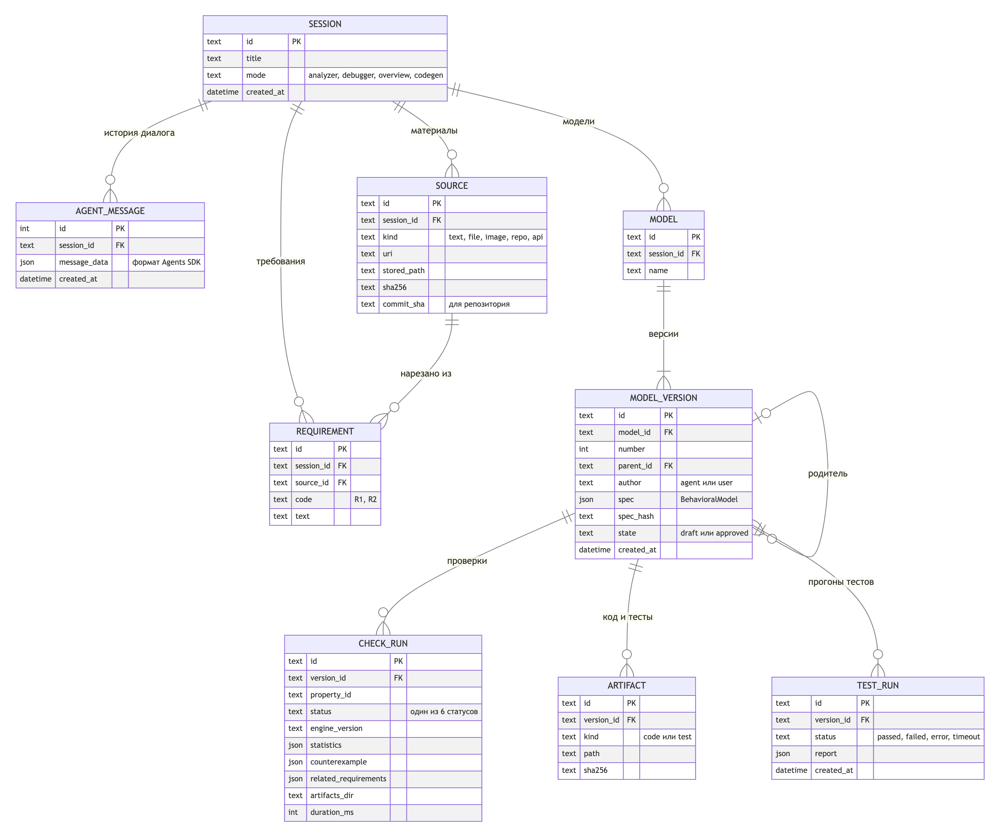

# Проверялка — ИИ-агент аналитик

Агент строит из текстового описания бизнес-процесса формальную модель состояний и переходов. Детерминированный Model Checker (TLC из TLA+ Tools) перебирает все достижимые состояния этой модели и, если находит нарушение правила, возвращает контрпример. Агент объясняет его на языке исходных требований.

LLM формализует и объясняет. Перебор состояний выполняет только TLC.

## Текущая реализация сервера

Добавлены FastAPI-каркас и SQLite-хранилище сессий, истории и текстовых
требований. Инструкции запуска и контракты: [docs/api.md](docs/api.md).
Транзакции, миграции и единая история для SDK: [docs/storage.md](docs/storage.md).
Снимок OpenAPI: [docs/openapi.json](docs/openapi.json).
Агент находится в `src/proveryalka/agent/`: Responses API и настраиваемый GPT/Codex subscription provider,
инструкции аналитика и запуск через `run_message(message, session)`.
Для истории используется `StoredSession` из серверного компонента.
Извлечение требований и формат аналитического результата: [docs/agent.md](docs/agent.md).
Из того же ответа без второго вызова LLM собирается [BehavioralModel 1.0](docs/behavioral-model.md).
JSON Schema и полные примеры находятся в `docs/schemas/` и `docs/examples/`.
Общий [интерфейс проверки](docs/verification.md) содержит шесть статусов,
проверку трасс, SDK-инструмент `check_behavior` и объяснение результатов.
Без адаптера ядра проверка не запускается; тестовые данные всегда помечены.
Уточняющий диалог запускается через `start_dialogue` и `reply_dialogue`:
вопросы, ответы, согласованные изменения и снимки разбора сохраняются в истории.
Незавершённый ход можно явно продолжить после сбоя; после согласованного изменения
доступно сравнение сохранённых результатов проверок до и после уточнения.
Проверяющее ядро на настоящих SANY/TLC — `src/proveryalka/checker/`: установка,
поддерживаемый DSL, лимиты, статусы и материалы запусков описаны в
[src/proveryalka/checker/README.md](src/proveryalka/checker/README.md).
HTTP-контракт основного сценария (текст или документ → уточнения → модель →
ручной запуск TLC → объяснение отчёта → правка и повторная проверка):
[src/proveryalka/api/README.md](src/proveryalka/api/README.md).
Разделы «Схема БД», «API» и «MCP» ниже частично описывают целевую архитектуру.
MCP остаётся целевой архитектурой; генератор Python/FastAPI/pytest и Docker-песочница подключены в `src/proveryalka/codegen/`.

Веб-клиент, запуск live/demo и границы проверок: [frontend/README.md](frontend/README.md).
Поставка frontend + backend + SQLite + TLC одним native-процессом, persistence,
readiness/shutdown, обязательный CI и ручной provider lane:
[Запуск основной версии](reports/runtime-runbook.md).

## Структура проекта

```text
src/proveryalka/
  agent/            агент, промпт, настройка LLM и раннер
  behavior/         общий контракт, проверка типов и семантика одного шага
  verification/     контракт результата и интерфейс проверяющего адаптера
  checker/          ядро проверки: перевод в TLA+, запуск SANY/TLC, разбор, материалы, кэш
  api/              приложение FastAPI и HTTP-маршруты
  storage/          SQLite, история диалогов и миграции
  config.py         настройки приложения
  contracts.py      общие структуры данных
  services.py       интерфейс серверного адаптера
tests/              проверки; эталонные модели в tests/fixtures/models/
scripts/            fetch_tla2tools.sh — закреплённая сборка TLC
docs/               документация и ТЗ
assets/             материалы документации
junk/               локальные вспомогательные материалы, исключены из Git
```

## Схема БД

SQLite в томе Docker. Загруженные материалы, клоны репозиториев, файлы `.tla`/`.cfg`, логи TLC и сгенерированный код лежат на диске, а в базе хранятся пути к ним и хэши.



Исходник диаграммы: [assets/db-schema.mmd](assets/db-schema.mmd) (Mermaid).

| Таблица | Что хранит |
|---|---|
| `SESSION` | Чат и его режим: анализатор, дебаггер, обзор проекта, генератор кода |
| `AGENT_MESSAGE` | Единая история диалога в `agent_messages`; API и адаптер `StoredSession` используют одну таблицу |
| `SOURCE` | Материалы пользователя: текст, файлы, изображения, репозитории, API |
| `REQUIREMENT` | Пронумерованные требования R1…Rn, на которые ссылаются элементы модели |
| `MODEL` | Модель как сущность: имя и чат |
| `MODEL_VERSION` | Неизменяемая версия модели. `spec` — вся модель в JSON, `parent_id` — версия-родитель, `state` — черновик или утверждена |
| `CHECK_RUN` | Одна проверка одного свойства одной версии: статус, контрпример, статистика, связанные требования |
| `ARTIFACT` | Сгенерированный код и тесты |
| `TEST_RUN` | Прогон тестов в песочнице |

Решения:
- **Версии модели неизменяемы.** Любая правка агента или пользователя создаёт новую версию со ссылкой на родителя. Проверки, код и тесты привязаны к конкретной версии.
- **Модель хранится одним JSON.** Модель читается и пишется целиком по контракту BehavioralModel 1.0. Pydantic проверяет структуру, типы и ссылки при чтении.
- **Связи с требованиями лежат внутри модели.** Переходы и свойства хранят `requirement_ids`, а `source_refs` находятся в каталоге требований модели. Зависимости выражены условиями переходов. `related_requirements` вычисляется детерминированно из переходов контрпримера.
- **Кэш проверок.** Чекер детерминирован, поэтому результат переиспользуется по ключу `(spec_hash, property_id, engine_version)`.

## API

Одно приложение FastAPI: REST и SSE для веб-интерфейса, MCP для кодинг-агентов. OpenAPI-документация генерируется автоматически на `/docs`.

### REST

| Метод | Путь | Назначение |
|---|---|---|
| `POST` | `/api/sessions` | Создать чат с режимом |
| `GET` | `/api/sessions` | Список чатов |
| `GET` | `/api/sessions/{id}` | Чат: сообщения, материалы, текущая модель |
| `POST` | `/api/sessions/{id}/sources` | Загрузить файл или изображение (multipart), подключить репозиторий или API |
| `POST` | `/api/sessions/{id}/messages` | Отправить сообщение агенту, в ответ `run_id` |
| `GET` | `/api/runs/{run_id}/events` | Поток событий агента (SSE) |
| `GET` | `/api/models/{id}/versions` | Список версий модели |
| `GET` | `/api/models/{id}/versions/{n}` | Версия модели |
| `POST` | `/api/models/{id}/versions` | Ручная правка: создаёт новую версию |
| `POST` | `/api/models/{id}/versions/{n}/approve` | Утвердить версию |
| `POST` | `/api/models/{id}/versions/{n}/checks` | Запустить проверку без LLM |
| `GET` | `/api/checks/{id}` | Результат проверки |
| `GET` | `/api/checks/{id}/artifacts/{name}` | Файлы прогона: `.tla`, `.cfg`, лог TLC |
| `POST` | `/api/models/{id}/versions/{n}/codegen` | Сгенерировать реализацию по утверждённой модели |
| `POST` | `/api/models/{id}/versions/{n}/tests/run` | Прогнать тесты в песочнице |
| `GET` | `/api/models/{id}/versions/{n}/export` | Архив проекта |

#### Пример: запуск проверки

```http
POST /api/models/m_42/versions/1/checks
Content-Type: application/json

{ "property_ids": ["P2"] }
```

```json
{
  "status": "PROPERTY_VIOLATED",
  "property_id": "P2",
  "engine": "TLC",
  "related_requirements": ["R1", "R2"],
  "counterexample": {
    "steps": [
      {"number": 0, "state": {"status": "Created", "approved": false, "cancelled": false}},
      {"number": 1, "transition": "Approve", "state": {"status": "Approved", "approved": true, "cancelled": false}},
      {"number": 2, "transition": "Cancel", "state": {"status": "Cancelled", "approved": true, "cancelled": true}},
      {"number": 3, "transition": "Execute", "state": {"status": "Executed", "approved": true, "cancelled": true}}
    ]
  }
}
```

Статусы проверки: `PROPERTY_HOLDS`, `PROPERTY_VIOLATED`, `MODEL_INVALID`, `TIMEOUT`, `STATE_LIMIT_REACHED`, `ENGINE_ERROR`. `TIMEOUT` и `STATE_LIMIT_REACHED` никогда не трактуются как `PROPERTY_HOLDS`.

### События SSE

| Событие | Когда приходит |
|---|---|
| `message_delta` | Очередной фрагмент текста агента |
| `tool_call` | Агент вызвал инструмент |
| `model_proposed` | Появилась новая версия модели, интерфейс обновляет диаграмму |
| `clarification_requested` | Агент задаёт уточняющий вопрос с вариантами ответа |
| `check_started` / `check_finished` | Начало и результат проверки |
| `file_written` | Сгенерирован файл кода или теста |
| `run_finished` | Агент закончил работу |
| `error` | Ошибка |

### MCP (`/mcp`, Streamable HTTP)

Инструменты для кодинг-агентов (Claude Code, Cursor):

| Инструмент | Что возвращает |
|---|---|
| `get_model(model_id, version?)` | Утверждённую модель |
| `check_behavior(model_id, version, property_ids?)` | Результаты проверки свойств |
| `get_tests(model_id, version)` | Тесты, выведенные из модели |
| `compare_with_code(model_id, version, files)` | Места, где код расходится с моделью |

## Версии моделей (#22)

Создайте модель через `POST /api/sessions/{session_id}/models` с `{"name":"Заявка"}`
и `Idempotency-Key`. Затем `POST /api/models/{model_id}/versions` принимает
`{"spec": BehavioralModel, "parent_id": null}`. Источники spec должны уже быть
сохранены в той же сессии и совпадать с ними по тексту. Требования и source_refs
сохраняются целиком внутри неизменяемого spec. Без parent_id родителем становится
последняя версия; явный parent_id должен принадлежать той же модели.
Номера выделяются в транзакции. Повтор ключа возвращает прежний ответ, новое
тело с прежним ключом — 409. Approve меняет только флаг согласования.
Миграция 002 применяется автоматически и сохраняет старые сессии.

## Проверки версий (#23)

`POST /api/models/{id}/versions/{n}/checks` с Idempotency-Key принимает
property_ids (по умолчанию все) и limits по общему CheckLimits. Ответ 202 содержит
run_id; `GET /api/runs/{run_id}` — состояние, `GET /api/checks/{run_id}` —
результаты. Пока проверка выполняется, results пуст. Согласование версии не
обязательно. TLC работает в фоне; сохраняются его реальные статусы, лимиты и
связь с неизменяемой версией. После перезапуска незавершённые run становятся
failed, завершённые результаты сохраняются. Для повторного запуска нужен новый
Idempotency-Key. Запускайте один процесс приложения на одну SQLite-базу.

## Диагностические файлы (#25)

`GET /api/checks/{run_id}/artifacts` возвращает манифест файлов.
`GET /api/checks/{run_id}/artifacts/{name}` выдаёт только файл из этого списка;
вложенные имена вроде logs/tlc.out допустимы, выход за каталог — нет.
Проверяются run_id, версия, spec_hash и SHA-256 файла. Для активной проверки
возвращается 409, для отсутствующих, повреждённых или чужих материалов — 404.
У API пока нет пользовательской аутентификации: доступ только локальный.

## Агент и SSE (#24)

`POST /api/sessions/{id}/messages` запускает существующий Analyst Agent в фоне
и возвращает 202/run_id. Настройки провайдера — OPENAI_BASE_URL и OPENAI_API_KEY.
Одна сессия допускает один активный агентный run; другая сессия независима.
История хранится через StoredSession, предлагаемые модели — как новые версии.
Повтор Idempotency-Key не вызывает LLM второй раз. После ошибки сохранённый
pending-turn можно повторить тем же текстом с новым ключом.

`GET /api/runs/{run_id}/events` выдаёт сохранённые SSE-события и продолжает поток.
Last-Event-ID — номер события внутри этого run; курсор впереди истории даёт 409.
Клиент устраняет повторы по паре run_id/event_id. Отключение SSE не отменяет run.
Агент сейчас возвращает структурированный turn: message_delta передаётся одним
фрагментом после генерации, не имитирует поток токенов. События check_started и
check_finished доступны для run проверок. Ошибки провайдера не отражают секреты.

## Диалог, объяснение проверки и документы

`GET /api/sessions/{id}/dialogue` возвращает типизированное состояние разбора:
требования с кодами R1…Rn и цитатами, вопросы и их статусы, явные правки,
готовность модели, ссылку на версию и незавершённый ход. Ответ на конкретный
вопрос — `{"text", "question_id"}` в `POST /messages`; разбор документа —
`{"source_id"}` после `POST /api/sessions/{id}/documents` (TXT, MD, DOCX).
TLC запускается только запросом проверки версии. С `"explain": true` после
сохранения отчёта объяснение того же отчёта ставится в очередь отдельным run;
сбой объяснения не меняет результат проверки, повтор —
`POST /api/checks/{id}/explanation` без нового запуска TLC. Явная отмена хода
освобождает диалог, сбой провайдера или остановка сервера сохраняют ход для
`pending/retry` либо `pending/discard`. Подробности и коды ошибок — в
[src/proveryalka/api/README.md](src/proveryalka/api/README.md).

Аналитик по умолчанию в `.env.example` работает через локальный
`codex app-server` с подпиской ChatGPT (`PROVERYALKA_LLM_PROVIDER=codex`,
нужен выполненный `codex login`); приложение запускает отдельный процесс без
инструментов, сети и MCP-серверов пользователя. `PROVERYALKA_LLM_PROVIDER=openai`
оставляет OpenAI-совместимый Responses API по ключу.

## Отмена и лимиты (#27)

`POST /api/runs/{id}/cancel` идемпотентен: активный запуск сначала cancelling,
затем cancelled после завершения инструмента. Завершённые результаты не
перезаписываются. Остановка сервера отменяет и дожидается активных операций.
`error_code` в Run хранит CANCELLED, SERVER_RESTARTED, RUN_TIMEOUT либо код сбоя.
SSE сохраняет терминальное событие и ошибку без ответа провайдера/секретов.

PROVERYALKA_MAX_PENDING_RUNS ограничивает общую очередь (32),
PROVERYALKA_AGENT_PARALLEL и PROVERYALKA_CHECK_PARALLEL — активные run (по 2).
PROVERYALKA_AGENT_TIMEOUT ограничивает LLM-run (630 секунд),
PROVERYALKA_MAX_INPUT_CHARS — текст (100000). Переполнение очереди — HTTP 429,
повтор уже принятого Idempotency-Key не расходует дополнительное место.
PROVERYALKA_TLC_PARALLEL отдельно ограничивает процессы свойств внутри проверки.

## Воспроизводимый локальный запуск (#26)

Проверенное окружение: Python 3.12.14, Temurin JRE 21.0.13+9,
TLA+ Tools v1.8.0 (SHA-256 проверяется scripts/fetch_tla2tools.sh).
v1.8.0 — prerelease, его ассет 30.10.2026 заменён сборкой TLC 2026.10.30.154139
rev 090e85c с SHA-256 `011267fc…0e7e10cd`; прежний pin `fc6878c6…` больше не
скачивается. Новый digest совпадает с digest ассета в GitHub API, тесты с настоящим
TLC пройдены на этой сборке (Java 25, Python 3.12). При следующей замене ассета
скрипт остановится с ошибкой sha256 — обновляйте pin так же осознанно.
Полный набор Python-зависимостей закреплён в requirements-runtime.lock.
На чистой машине установите Python 3.12 и Temurin 21, затем из корня:

```sh
python3.12 -m venv .venv
.venv/bin/python -m pip install -r requirements-runtime.lock
.venv/bin/python -m pip install --no-deps -e .
sh scripts/fetch_tla2tools.sh
cp .env.example .env
# Для GPT-подписки оставьте provider=codex и настройте локальный app-server.
# Для явно выбранного Responses API нужны endpoint/model/key; секреты не коммитятся.
sh scripts/run-server.sh
```

Это документированный локальный вариант поставки, без Docker.
Команда выше запускает только API. Для собранного UI на том же origin выполните
`npm --prefix frontend ci`, `npm --prefix frontend-extensions ci`,
`npm --prefix frontend run build`, затем `sh scripts/run-stack.sh`.
Требуется Node.js 24; интерфейс откроется на `http://127.0.0.1:8000`.
Docker нужен отдельно для песочницы generated tests, без переноса подписочной авторизации.
Если Java не в PATH, укажите абсолютный PROVERYALKA_JAVA в .env.
`python -m proveryalka.runtime` проверяет SQLite, запись артефактов, Java и jar
до запуска сервера; ключ LLM не проверяется запросом и не выводится.
`/health` означает живой HTTP-процесс, `/ready` — доступные SQLite и TLC;
agent_configured отражает наличие настроек, а не успешную авторизацию LLM.

Каталог data/ постоянный: SQLite, материалы проверок, кэш. Не удаляйте его
между запусками; для переноса используйте резервную копию SQLite при остановленном
сервере вместе с артефактами. Миграции применяются автоматически. Один процесс
сервера на одну БД; запуск нескольких workers не поддерживается. Ctrl+C
останавливает агентные операции и дочерние TLC, дожидаясь сохранения статусов.

```sh
PROVERYALKA_REQUIRE_TLC=1 .venv/bin/python -m pytest -q
```

`tests/test_api_tlc.py` проверяет оба acceptance scenarios через HTTP: создание
сессии/источника/версии, реальный TLC, результат, файлы и сохранение после
перезапуска. Для реального LLM нужны внешние учётные данные; детерминированные
тесты агента выполняются с тестовым провайдером и не расходуют API-бюджет.
